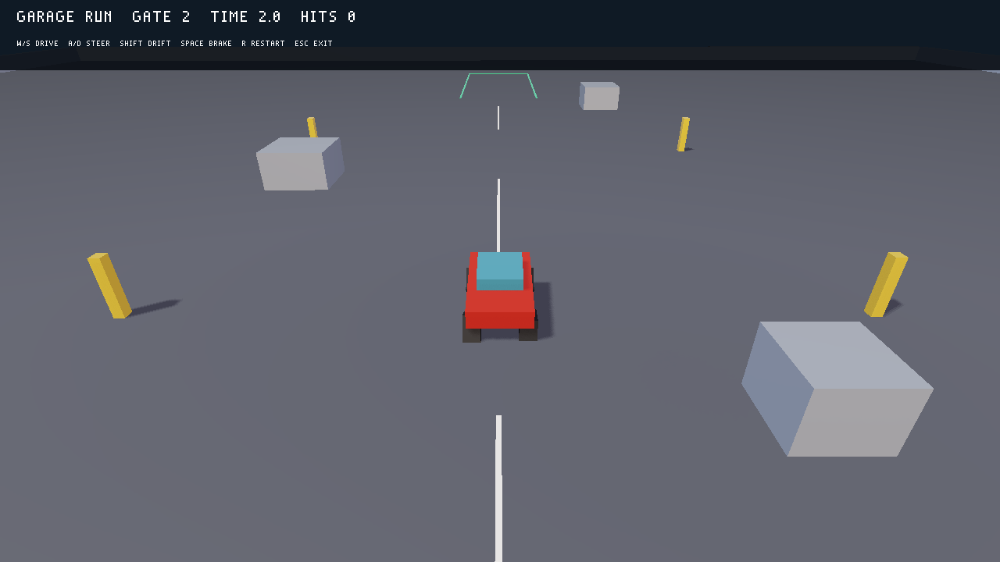
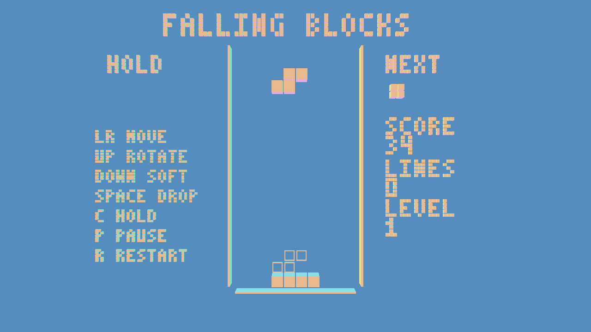
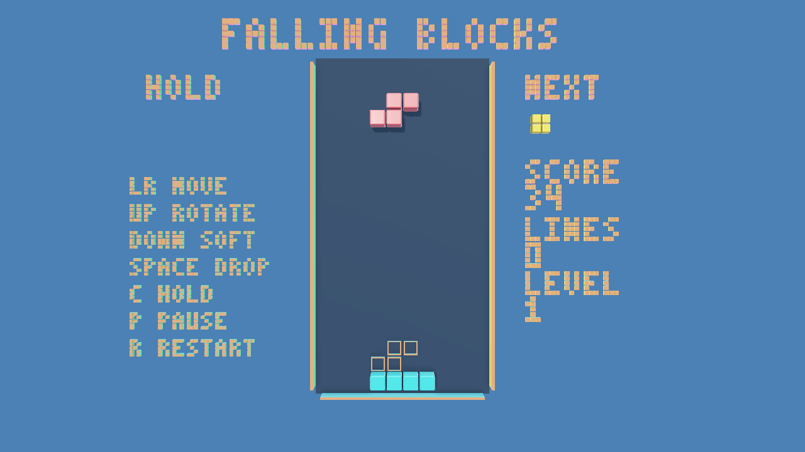
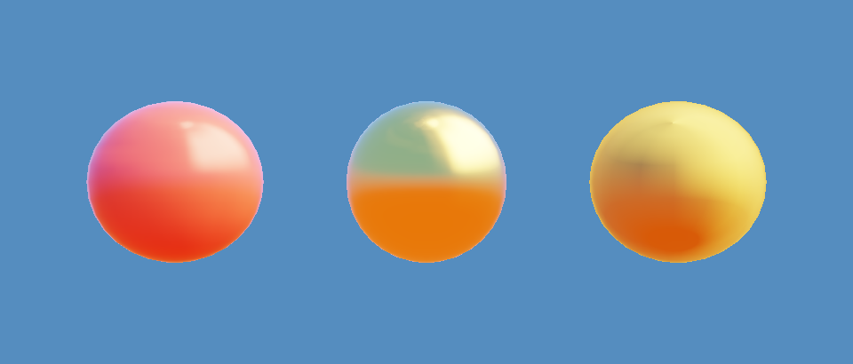
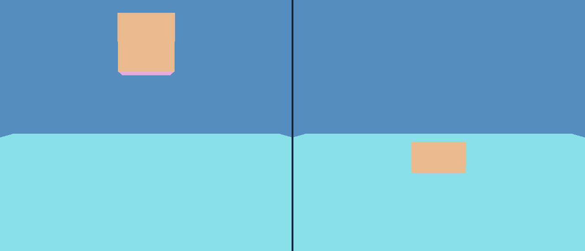
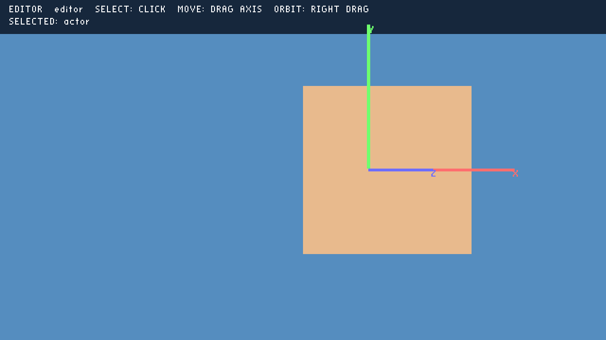

# AI Game Engine

**ThreePoint today:** a source-authored 3D engine and three playable Linux sample projects. [See real screenshots](#screenshots), [run a game](#try-it), or [check the visual editor's status](#visual-scene-editor-status). The original project brief below is retained as the source of truth; the later Linux-only decision supersedes its platform list.

We're building a production-grade, simple and straight-forward 3D Game Engine for Windows, macOS and Linux (Ubuntu 24+). This is professional-grade software that needs to be stable, fully-tested, and real-world deployable. No hacks, no shortcuts - solid as a rock.

## Dev Workflow
- Ask questions only when absolutely necessary - work autonomously
- IMRORTANT! DO NOT look outside of working directory or use other code on my computer as reference
- Start by asking question to determine engine name. Suggest a few
- Testing is of the utmost importance - use lots of unit tests (any framework, simple is good), run automated testing
- Setup a scene used for testing, which tests every single feature in the engine - all components, and entire scripting API
- Do things properly, this is production-grade and not a hack project
- Create AGENTS.md and relevant skills to support development, and contain concrete development guidelines

## Tech stack
- C++ and CMake for core engine
- [GLFW](https://github.com/glfw/glfw) and [nvrhi](https://github.com/NVIDIA-RTX/NVRHI), using Vulkan primarily on all platforms
- [glm](https://github.com/g-truc/glm) for math
- [miniaudio](https://github.com/mackron/miniaudio) for audio
- Lua for scripting, though this can be up for discussion

## Basic Architecture
- Static library for core engine, executable for editor and runtime (depending on chosen design)
- Need to have editor to build games - this can be embedded into runtime executable (and stripped from distribution builds), or can be a standalone executable
- Simple ECS perhaps, to author scene with entities and components
- Ability to "export" game - executable that runs game without editing ability that we can distribute
- Editor needs to be fully controllable by AI agents - I should be able to ask you to build me a game like Tetris, and you should have all the tools available to do so without my intervention

## 3D Renderer
- Import gltf meshes with materials and textures
- Editor has gizmo to position them in the world
- PBR material workflow
- IBL with HDRIs from https://polyhaven.com/hdris
- Soft shadow maps
- Good SSAO
- HDR pipeline with tonemapping

## 3D Physics
- Use simple 3D physics library of your choosing
- Controllable via scripting, authored via components in editor

## Behavior
- Scripting with Lua (or other chosen language)
- Control entities/components and run in update loop, and entity destruction/creation
- Spawn new entities/prefabs

## Screenshots

These are Vulkan captures of the checked-in games and feature scenes on Linux. The games run from Lua, scene files, and assets without editor clicks.

### Garage Run

The Lua-authored car game uses a Jolt four-wheel vehicle, collision and checkpoint triggers, PBR glTF meshes, HDRI lighting, spatial audio, and a chase camera. The obstacle faces shown here have SSAO disabled to avoid camera-dependent bands.



### Falling Blocks

The original game and its separate PBR-lit version use the same source-authored rules: a seven-piece bag, wall kicks, hold, next and ghost pieces, scoring, levels, pause, and restart. The lit version adds glTF materials, an HDRI, and tile shadows.

| Original | PBR-lit version |
| --- | --- |
|  |  |

### Renderer and physics examples

The feature scene exercises HDRI-lit PBR materials. Its physics example shows a Lua-authored body before and after falling onto a Jolt collider (left: first frame; right: frame 120).





### Scene editor viewport

The editor screenshot shows a selected entity and its translation gizmo in the current windowed viewport.



## Try it

On Ubuntu 24+ with `uv`, `git`, `curl`, `apt-get`, and a working Vulkan driver, run from the repository root:

```sh
bash scripts/bootstrap-local.sh
build/threepoint run games/garage_run
build/threepoint run games/falling_blocks
build/threepoint run games/falling_blocks_lit
```

`bootstrap-local.sh` keeps pinned build tools and dependencies in the project's ignored `.tools/` directory and runs the available tests. [RELEASE.md](RELEASE.md) covers standalone Linux game archives.

## Visual scene editor status

The editor is an early scene viewport plus source-file commands. In the window, you can open a declarative Lua scene, select a cube or imported glTF bound, orbit with right-drag, and drag X/Y/Z handles to change an entity's position. Releasing a handle saves the transform to the same `.scene.lua` file used by the game. Try `build/threepoint-editor viewport tests/feature_scene editor --select actor`; close the window with the window manager.

The `threepoint-editor` CLI can list and inspect entities, add entities, change component fields, and read or replace Lua source. Games remain fully authorable through those files and CLI commands. The window does not yet have a scene tree, component inspector, asset browser, or rotation and scale gizmos. It cannot graphically edit computed Lua scenes or move a parented imported mesh. See [Phases 20–22](PLAN.md) for the tested editor scope.

## Implementation plan

The requirements above are the source of truth. [PLAN.md](PLAN.md) maps each requirement to small, testable phases and records the current state. The existing SDL3/Lua program is a 2D prototype; it does not satisfy the 3D renderer or physics requirements. The first visible 3D demo is complete in Phase 3, and the first Lua-authored 3D demo is complete in Phase 4.

**Priority update (2026-10-17):** A complete source-only 3D [Falling Blocks game](games/falling_blocks/README.md) now runs: a 2D rules grid displayed with 3D blocks. Rules, controls, HUD, score, and restart are written in Lua and project files, with no editor clicks. Advanced graphics and sound were added in later phases. The original 3D engine requirements above remain in scope.

Phases 10–12 provide a tested full match: a shuffled seven-piece queue, movement, wall kicks, hold, next/ghost previews, line clears, speed levels, visible score, pause, game over, and restart. Run `build/threepoint run games/falling_blocks` to play it now. Both this game and Falling Blocks Lit now pass standalone export, input-driven Vulkan capture, and live startup checks.

The separate [Falling Blocks Lit](games/falling_blocks_lit/README.md) copy uses source-generated glTF tiles with seven PBR colors, a dark board panel, a shadow-casting directional light, a checked-in studio HDRI, and restrained SSAO. Its colored tiles cast shadows; decorative cubes do not. Run `build/threepoint run games/falling_blocks_lit` to compare it with the original, or add `--scene ssao_off` to compare the lit game without SSAO. Both projects run directly from source without editor interaction. The art generator and rendered assets are in the copied project.

[Garage Run](games/garage_run/README.md) is the second source-only 3D game. Drive a rigid-body car through two ordered gates, avoid walls, and brake in a parking bay. Its Lua project uses PBR glTF assets, physics triggers and collisions, HDRI lighting, shadows, spatial sound, UI, and best-time saving. SSAO is disabled in this game to keep the flat obstacles free of camera-dependent bands. Run `build/threepoint run games/garage_run` from the repository root. The game and its assets need no editor clicks; the standalone export passes gameplay, Vulkan capture, and live startup checks.

Garage Run now uses Jolt rear-wheel drive, front-wheel steering, tire grip and handbrake slip in a 90×90 practice yard. Steering at rest turns the wheels without rotating the chassis. The larger yard includes a marked drift pad, scattered solid obstacles, two checkpoint gates, and a parking bay. Solid impacts move the chase camera according to contact direction and closing speed; a damped spring settles it. Engine RPM changes motor pitch, rear-wheel slip fades in a skid loop, and impact speed sets bump volume.

`build/threepoint test <project>` loads every declared source scene in a separate device-free runtime, then runs one fixed, update, and draw tick without opening a window. It reports the scene name with any Lua or asset error. Use the existing CTest suite for longer gameplay and visual checks. The feature-scene project includes an intentionally broken HDRI scene for negative testing, so the aggregate command is intended for playable projects.

`build/threepoint build <project> <output-directory>` checks every source scene and creates a standalone Linux bundle. Run `<output-directory>/threepoint-game` to play directly; the executable starts its bundled `game/` source files without an editor or development tools. `threepoint-game --check` validates that bundle without a window, while `--frames N --capture file.ppm` supports deterministic graphical checks. Export copies project Lua, glTF, binary buffers, textures, HDRIs, and WAV/MP3/FLAC files. It leaves out tests, saves, hidden files, README files, asset generators, and symlinks. The destination must be new and separate from the source project. `game.id` gives the bundle a stable identity when moved; saves go to `$XDG_DATA_HOME/threepoint/<game.id>/saves/`, or `$HOME/.local/share/threepoint/<game.id>/saves/` if XDG_DATA_HOME is unset. Rebuilding from the same project folder name retains that identity. The game bundle can be read-only. The bundle needs the Linux GLFW runtime, Vulkan loader, and a working Vulkan driver. Source and exported game checks reject missing or damaged glTF buffers, HDRIs, and sounds with errors naming the affected asset.

`bash scripts/package-linux-release.sh` packages the engine tools and all three playable sample games as separate Linux archives under `build/release/`, with SHA-256 hashes and bundled third-party notices. The [release guide](RELEASE.md) lists installation and launch commands. A test extracts the archives, runs each game without the checkout, and uses the packaged engine to export another game.

## Current implementation

**Platform scope update (2026-10-17):** The current target is Linux (Ubuntu 24+). Windows and macOS are no longer implementation or release gates, per the latest project direction. The original brief above is retained as supplied; this update supersedes only its platform list.

The C++ static core, separate runtime/editor targets, source-only feature scene, dependency record, and Linux CI workflow are in the repository. The runtime uses glm transforms, an indexed cube mesh, shaders, and depth-tested Vulkan rendering through nvrhi. A pinned Lua 5.4.8 runtime runs the feature scene, which creates and animates a 3D cube entirely through source files. Phase 5 adds named keyboard, mouse, and controller actions, pointer rays, and Lua camera control. Phase 6 adds entities and five script-accessible components. Phase 7 adds source-defined scenes, reusable prefabs, per-entity scripts, and scene switching. Phase 8 adds imported glTF geometry and node hierarchy. Phase 9 adds glTF textures, metallic/roughness materials, and direct-light PBR. The old 2D SDL3/Lua program is available as the optional `threepoint-2d-prototype` target. The local Release suite now includes an interactive scene startup check alongside GPU captures under Vulkan validation; hosted Ubuntu 24+ CI remains unverified until the workflow runs.

On this Ubuntu development machine, `bash scripts/bootstrap-local.sh` builds both targets and runs all available tests. `bash scripts/test-sanitizers-local.sh` builds a separate debug ASan/UBSan tree and runs the device-free suite; the normal Vulkan suite remains in `build/`. Run `build/threepoint run tests/feature_scene` to see the source-only Lua cube game. Run `build/threepoint run tests/feature_scene --scene imported` to see the imported glTF triangle, `--scene textured` for a textured quad, or `--scene spheres` for three PBR reference materials. For a reproducible 60th-frame capture, run `build/threepoint run tests/feature_scene --frames 60 --capture build/lua-cube.ppm`. `build/threepoint --preview` still shows the built-in rotating cube, and `--capture-clear` keeps the Phase 2 clear-frame check. No editor action is needed to run these Lua scenes.

The first 3D Lua API is `local tp = require("threepoint")`. In `start()`, call `tp.spawn({mesh="builtin:cube", position={0,0,0}, rotation={0,0,0}, scale={1,1,1}})` to get a stable cube ID. Set the optional `casts_shadows=false` on `tp.spawn` to keep decorative objects out of shadow maps. In `update(dt)`, call `tp.set_rotation(id, {x,y,z})` using radians, or read deterministic elapsed time with `tp.time()`. `tp.quit()` ends the run. Scripts return `start`, `fixed_update(dt)`, `update(dt)`, and optional `draw` callbacks. On a fast frame, including the first live frame, `update` and `draw` can run before any `fixed_update`; do not depend on a fixed tick having occurred in `draw`. See [the runnable feature-scene script](tests/feature_scene/scripts/main.lua). Invalid mesh names, nonfinite vectors, nonpositive scales, unknown IDs, and wrong argument counts raise Lua errors with callback context.

Declare named actions in `game.lua` under `input`, for example `turn = {keyboard="space", gamepad_button="a"}`. Supported controls are letters/digits and common navigation keys, left/right/middle mouse buttons, standard GLFW gamepad buttons, and left/right stick or trigger axes on the first connected gamepad. `tp.action("turn")` returns 0 when idle, 1 for pressed buttons, or a value from -1 to 1 for axes; if an action has multiple bindings, the strongest magnitude wins. `tp.pointer()` returns window coordinates. `tp.screen_ray(x,y)` returns `{origin={x,y,z}, direction={x,y,z}}` in world space. `tp.set_camera({eye={x,y,z}, target={x,y,z}, up={x,y,z}, fov=60, near=0.1, far=100})` changes the active perspective camera; omitted fields keep their prior values. The [feature-scene script](tests/feature_scene/scripts/main.lua) exercises these calls. For an automated held-key capture, run `build/threepoint run tests/feature_scene --frames 60 --capture build/held.ppm --hold-key space`.

Phase 6 adds `tp.entity_create(name?)`, `tp.entity_destroy(id)`, `tp.entity_exists(id)`, `tp.entities()`, and `tp.entity_name(id)`. IDs are positive and are never reused during a scene run. `tp.component_set(id, kind, values)` adds or changes a component, `tp.component_get(id, kind)` returns its values or `nil`, and `tp.component_remove(id, kind)` returns whether one was removed. The kinds and fields are:

| Kind | Fields |
| --- | --- |
| `transform` | `position`, `rotation` (radians), `scale` as three-number arrays; `parent` as another live ID, or `0` to detach |
| `camera` | `eye`, `target`, `up` as three-number arrays; `fov`, `near`, `far`, `active` |
| `light` | `type` (`point` or `directional`), `color`, `direction`, `intensity`, `shadows`, `shadow_range` |
| `mesh` | `mesh` (`builtin:cube` or a project-relative `.gltf`/`.glb` path), `visible`, `casts_shadows` (default true) |
| `script` | `path` (project-relative Lua file), `enabled` |

Fields omitted from `component_set` keep their current values. The active camera component controls rendering and screen rays. Visible cube mesh components render with their parent transforms. Directional and point light components illuminate imported glTF meshes; the scene supports up to eight lights.

In `game.lua`, `scenes = {main="scenes/main.scene.lua"}` maps scene names to files, and `prefabs = {cube="prefabs/cube.prefab.lua"}` optionally maps prefab names. A scene returns `{entities={...}, script="scripts/main.lua"}`. Each entity in that dense array can declare `name`, `transform`, `camera`, `light`, `mesh`, and `script` component tables with the same fields as `tp.component_set`. A scene transform can name another declared entity as its `parent`; a numeric Lua ID also works at runtime. See [the alternate source scene](tests/feature_scene/scenes/alternate.scene.lua). A prefab file returns one entity table with those fields; a scene entity may also set `prefab="cube"` before overriding its fields.

`tp.entity_find(name)` returns the first matching live ID or `nil`. `tp.prefab_spawn(name, overrides?)` creates a prefab instance and accepts an optional entity table of component overrides; invalid overrides leave no instance. `tp.scene_name()` reports the current scene, while `tp.scene_switch(name)` and `tp.scene_reload()` apply after the current callback stage. A scene change rebuilds entities from source, reruns the scene script's `start`, and resets scene time. IDs stay stable within a scene run and restart from 1 after a scene change. An enabled entity `script` file returns any of `start(id)`, `fixed_update(id, dt)`, `update(id, dt)`, and `draw(id)`. These callbacks run in entity ID order; newly spawned script components start on the next synchronization point. The [alternate scene script](tests/feature_scene/scripts/alternate.lua) exercises scene and prefab calls, and [the actor script](tests/feature_scene/scripts/actor.lua) exercises every per-entity callback.

`tp.spawn({mesh="assets/model.gltf", position={0,0,0}})` and mesh components import static triangle geometry from glTF 2.0 JSON or GLB files. Embedded buffers, project-local external buffers, vertex colors, and nested node transforms are supported. The [imported scene](tests/feature_scene/scenes/imported.scene.lua) uses a checked-in fixture; `--scene imported` selects it without editing the manifest. The loader checks asset paths, file sizes, accessor bounds, indices, and finite transforms before Vulkan upload. This phase rejects sparse or compressed geometry, skinning, morph targets, nontriangle primitives, required extensions, and external buffer URIs with percent escapes. Lua physics control, editor authoring, and export are implemented in later phases; multi-entity prefab composition remains open.

Phase 9 renders glTF normals, UVs, metallic/roughness and color factors, vertex colors, and PNG/JPEG base-color, metallic-roughness, normal, occlusion, and emissive textures. The PBR shader uses direct directional and point lights with a GGX highlight. The [textured quad](tests/feature_scene/scenes/textured.scene.lua) and [material spheres](tests/feature_scene/scenes/spheres.scene.lua) run entirely from source and pass Vulkan image checks. Hold Space in either scene to turn off its light; the shared Lua script updates the light component. The renderer uses linear, repeating texture sampling with one mip level; unsupported authored sampler modes, alternate UV sets, texture transforms, alpha blending, and material extensions fail during import.

Phase 13 renders 3D scenes into a 16-bit floating-point HDR image, then applies exposure, ACES-style tonemapping, and sRGB output to the display. Call `tp.set_exposure(number)` from Lua with a finite value from 0.01 to 32; each scene starts at 1.0. Compare the source-only bright material scenes with `build/threepoint run tests/feature_scene --scene hdr` and `--scene hdr_dim`. Vulkan captures verify that lowering exposure recovers detail in a bright highlight.

Phase 14 loads project-local, 2:1 Radiance `.hdr` environments as linear floating-point images and applies sampled diffuse and specular image-based lighting to glTF PBR materials. Call `tp.set_environment("assets/studio.hdr", 1.0)` in a scene script's `start()`; the optional intensity is from 0 to 32, and `tp.set_environment(nil)` clears it. Each new scene starts with no environment. Run `build/threepoint run tests/feature_scene --scene ibl` to see the checked-in HDRI fixture illuminating three materials without direct lights, or use `--scene ibl_off` to compare. The importer rejects missing, malformed, outside-project, non-2:1, over-64-MiB, or larger-than-4096×2048 images with named errors. Built-in colored cubes use an unlit shader; the HDRI currently lights glTF PBR geometry and is not drawn as a background.

**Poly Haven example:** Download a 1K or 2K Radiance `.hdr` from the [Poly Haven HDRI catalog](https://polyhaven.com/hdris), place it at `assets/studio.hdr` inside your game project, and call `tp.set_environment("assets/studio.hdr", 1.0)` and `tp.set_exposure(1.0)` in the scene script. The source-authored [feature-scene example](tests/feature_scene/scripts/ibl.lua) shows the same setup with a small checked-in fixture, so its automated test needs no download or editor action. On first use of an HDRI, the core prefilters it once into a 64×32 diffuse map and seven GGX roughness levels (256×128 through 4×2). PBR pixels then sample these maps instead of integrating 64 directions each frame; changing an HDRI incurs a brief CPU prefilter and GPU upload.

Phase 15 adds soft shadow maps to point and directional lights. Set `shadows=true` on a source scene's light component or with `tp.component_set(id, "light", {shadows=true})`; the default is false. `shadow_range` is a finite number from 0.1 to 1000 (default 25). For a point light it is the shadow distance; for a directional light it is the half-width of a box centered on the light entity's transform position. Built-in cubes and glTF meshes cast shadows; glTF PBR surfaces receive them, and alpha-masked glTF cutouts do not cast opaque shadows. Each shadow face now uses a 1024×1024 map with a 3×3 soft filter. The atlas packs shadowed lights into rows, using 24 MiB for one shadowed light and up to 192 MiB for eight. It grows when more shadowed lights are needed and retains its peak size while the runtime stays open. Compare `build/threepoint run tests/feature_scene --scene shadow` with `--scene shadow_off`, or `--scene shadow_point` with `--scene shadow_point_off`. The built-in cube remains an unlit receiver.

Phase 16 adds screen-space ambient occlusion (SSAO). In a scene script, call `tp.set_ssao(quality, radius, strength)`: quality is an integer 0–3 (0 disables it), radius is optional and ranges from 0.05 to 5 world units (default 0.35), and strength is optional and ranges from 0 to 4 (default 2). Each scene starts with SSAO off. The renderer reconstructs nearby surfaces from scene depth, writes an occlusion factor at half display resolution, and blurs/upscales it across pixels with similar depth. This cuts the expensive sample pass to about one quarter as many output pixels. Compare `build/threepoint run tests/feature_scene --scene ssao` with `--scene ssao_off`; `--scene ssao_low` shows the low sample count. The fixture is authored entirely in scene and Lua files. SSAO is a screen-space approximation, so geometry hidden from the camera cannot contribute; high quality still has a higher GPU cost. Oblique flat faces can show camera-dependent bands, so Garage Run disables SSAO until that renderer limitation is resolved.

Phase 17 adds [Jolt Physics](DEPENDENCIES.md) to the static C++ core. `threepoint::PhysicsWorld` in [physics_world.hpp](include/threepoint/physics_world.hpp) creates static, dynamic, and kinematic box or sphere bodies, including nonblocking sensor triggers. Positions use Y up and meters; `step()` advances exactly 1/60 second under gravity. `state(id)` reads position, rotation, velocity, and activity; `contacts()` lists solid and trigger entry/exit events from the last step. The [core physics fixture](tests/feature_scene/physics_core_test.cpp) tests falling, resting, solid collisions, trigger pass-through, deterministic repeat runs, and bad inputs; run it with `ctest --test-dir build -R physics_core --output-on-failure`.

Phase 18 connects physics to source scenes and Lua. Give an entity an unparented `transform`, then a `physics` component, for example `{motion="dynamic", shape="box", half_extents={0.4,0.4,0.4}}`; use `radius` for a sphere, `velocity` for initial motion, and `trigger=true` for a nonblocking sensor. `tp.component_set/get/remove(id, "physics", ...)` also works at runtime. Physics advances before each 60 Hz `fixed_update`, updates the entity transform for rendering, and resets when the scene changes. Call `tp.physics_state(id)` for position, Euler rotation, velocity, and activity; `tp.physics_set_velocity(id, vec)`, `tp.physics_move(id, position)`, `tp.physics_set_pose(id, position, euler_rotation)`, `tp.physics_apply_force(id, vec)`, or `tp.physics_apply_impulse(id, vec)` to control a body. `physics_set_pose` was added for the Phase 26 car game and synchronizes the visual transform with the collider's position and yaw. Forces and impulses require a dynamic body. `tp.physics_raycast(origin, direction, distance)` returns the nearest `{id, position, distance}` or `nil`; `tp.physics_overlap_sphere(center, radius)` returns sorted entity IDs. `tp.physics_contacts()` returns `{first, second, trigger, began, normal, closing_speed}` events for the current fixed tick, where `began=false` means exit. The entry normal points from `first` to `second`; `closing_speed` is their relative speed into that normal before collision resolution. Exit events have a zero normal and speed. The [physics scene](tests/feature_scene/scenes/physics.scene.lua) and [Lua script](tests/feature_scene/scripts/physics.lua) exercise these calls without editor input. Run `build/threepoint run tests/feature_scene --scene physics` to watch a cube fall through a trigger and settle on the floor; `physics_scene_capture` checks the visible movement under Vulkan validation. Collider dimensions are authored separately from visual mesh scale, so keep them aligned when creating a game.

A dynamic box can also use Jolt's four-wheel vehicle constraint. In `start()`, call `tp.vehicle_attach(id, {half_track=0.55, half_wheelbase=0.72, wheel_radius=0.28, engine_torque=800, rear_grip=0.75})`. In `fixed_update()`, set controls with `tp.vehicle_set_input(id, {throttle=1, steer=0, brake=0, handbrake=0})`, then inspect `tp.vehicle_state(id)` for engine RPM and four wheel entries (`grounded`, `steer`, `rotation`, `lateral_slip`). The front pair steers, the rear pair receives torque, and the handbrake reduces rear lateral grip. Controls take effect on the next fixed physics tick. The [vehicle feature scene](tests/feature_scene/scenes/vehicle.scene.lua) tests invalid calls, stationary steering, wheel contact, and rear-wheel motion without editor work. Garage Run uses this API for rear drive, steering, drift, impact response, and engine sound.

Phase 19 adds timers, saves, and source-defined UI. Lua can call `tp.timer_start(name, seconds, repeat?)`, `tp.timer_cancel(name)`, `tp.timer_remaining(name)`, and `tp.timer_events()`. Names use 1–64 letters, digits, or underscores; durations range from 1/60 to 3600 seconds. Timers advance once per simulated 60 Hz tick, emit names in deterministic order before `fixed_update`, and reset with the scene. The [timer fixture](tests/feature_scene/scripts/timers.lua) checks one-shot and repeating events, cancellation, and invalid values.

Lua can persist game state with `tp.save(slot, value)` and restore it with `tp.load(slot)`; a missing slot returns `nil`. Values may contain finite numbers, integers, booleans, strings, and nested tables with string or integer keys. Cycles, unsupported Lua values, nonfinite numbers, more than 16 nesting levels, more than 10,000 table entries, and saves over 1 MiB raise errors. Slot names use 1–64 letters, digits, underscores, or hyphens. Saves are versioned files in the project's `saves/` directory and are replaced atomically. The [save fixture](tests/feature_scene/scripts/save.lua) reopens a source game in fresh engine instances and checks the restored state.

Phase 19 also adds source-defined screen UI. In `draw()`, use `tp.ui_rect(x,y,width,height,r,g,b,a)` with colors from 0 to 1, `tp.ui_text(x,y,text,scale)`, and `tp.ui_button(id,x,y,width,height,label)`. Button calls return true on a new left click or Enter press. The first button gets keyboard focus; Tab moves focus in draw order, and `tp.ui_focus()` reads or sets its ID. `tp.viewport_size()` returns width and height so pixel layouts can adjust on resize. Up to 256 items may be drawn per frame, and this initial built-in font accepts printable ASCII text. The [menu fixture](tests/feature_scene/scripts/menu.lua) starts a game by mouse or keyboard and restores its saved visit count in a fresh engine instance. Run `build/threepoint run tests/feature_scene --scene menu` to try it. The UI is composited after tonemapping, so it remains legible over HDR scenes. Richer text rendering and editable controls are future UI work.

Phase 20 adds a command-line scene editor. `build/threepoint-editor tree <project> <scene>` shows the parent tree and component names; `inspect <project> <scene> <entity>` shows component values. `add <project> <scene> <entity>` creates an entity, and `set <project> <scene> <entity> <component> <field> <Lua value>` changes a component field; for example, pass `'{2, 0, 0}'` as a position or `'"builtin:cube"'` as a mesh value. Each edit writes the same `.scene.lua` file that `threepoint run` loads. Run `build/threepoint-editor tree tests/feature_scene editor` to inspect the [editor fixture](tests/feature_scene/scenes/editor.scene.lua); copy a project before experimenting with edits. Tests open, edit, save, reopen, and run the scene, and reject an external change made after opening. This editor accepts declarative `return {...}` scene files; computed scenes that execute setup code are currently unsupported, with a clear error. A graphical viewport and gizmos are Phase 21 work.

Phase 21 adds a windowed 3D editor viewport. Run `build/threepoint-editor viewport <project> <scene>` to inspect a declarative scene. Left-click a visible entity to select it, drag an X/Y/Z handle to move it, right-drag to orbit the camera, and press Escape to clear selection. The editor previews the move, then saves the entity's local `transform.position` into the source scene on release; the game runtime reads that file directly. `--select <entity> --frames 2 --capture <ppm-file>` supports automated captures. Try `build/threepoint-editor viewport tests/feature_scene editor --select actor` to view the checked-in fixture without changing it. Tests verify parented-cube transforms survive save/reopen, plus Vulkan pixels and interactive startup. The viewport loads source-authored geometry without executing gameplay callbacks. It selects built-in cubes and imported glTF bounds; moving a parented imported mesh is currently unavailable, and computed Lua scenes remain outside this editor path.

Phase 22 adds exact Lua source viewing and replacement to the same editor. `build/threepoint-editor source <project> <relative.lua>` prints `game.lua`, a scene, or a script without changing its bytes; `build/threepoint-editor replace <project> <relative.lua>` reads replacement Lua from standard input. For example, `build/threepoint-editor source tests/feature_scene scripts/editor.lua` shows the fixture script. To edit a copied project, write a Lua file there and pipe it into `replace`; the editor checks Lua syntax, preserves file permissions, and atomically replaces only that project file. It rejects paths outside the project and stale edits made after a document was opened. Raw source editing retains comments and computed scene code, while the scene tree and gizmo remain for declarative scenes. A hand edit, a source editor edit, save/reopen, and actual runtime behavior are covered by automated round-trip tests. This editor accepts source through both CLI commands and ordinary text editors, with no private project database or required clicks.

Phase 25 adds miniaudio sound before export work, following the updated priority. In Lua, `tp.sound_play("assets/contact.wav", {position={0,0,0}, volume=0.8})` returns a sound ID. Omit `position` for ordinary 2D sound; options also include `spatial` and `loop` booleans. Use `tp.sound_set_position(id, vec)`, `tp.sound_set_volume(id, 0..4)`, `tp.sound_set_pitch(id, 0.25..4)`, `tp.sound_stop(id)`, and `tp.sound_state(id)`; a missing or stopped ID has no state. `sound_play` also accepts an initial `pitch`, and sound state reports it. Set the 3D listener with `tp.sound_set_listener(position, forward, up)` using independent direction vectors. Sound files must stay inside the project and be at most 16 MiB; miniaudio's built-in WAV, MP3, and FLAC decoders are enabled. A scene switch stops its sounds. If no output device initializes, the engine still simulates sound state without speaker output. Run `build/threepoint run tests/feature_scene --scene audio` to watch the body hit the floor and hear the generated contact cue on a working output device. The cue is reproducibly generated by [generate_contact_sound.py](scripts/generate_contact_sound.py); the feature-scene asset is checked in so running a game needs no generation step or editor click. Device-free tests verify PCM decoding, spatial panning, volume, stop, and invalid calls; the live Vulkan startup check passes. Physical speaker playback quality remains to be checked on the user's output hardware.
