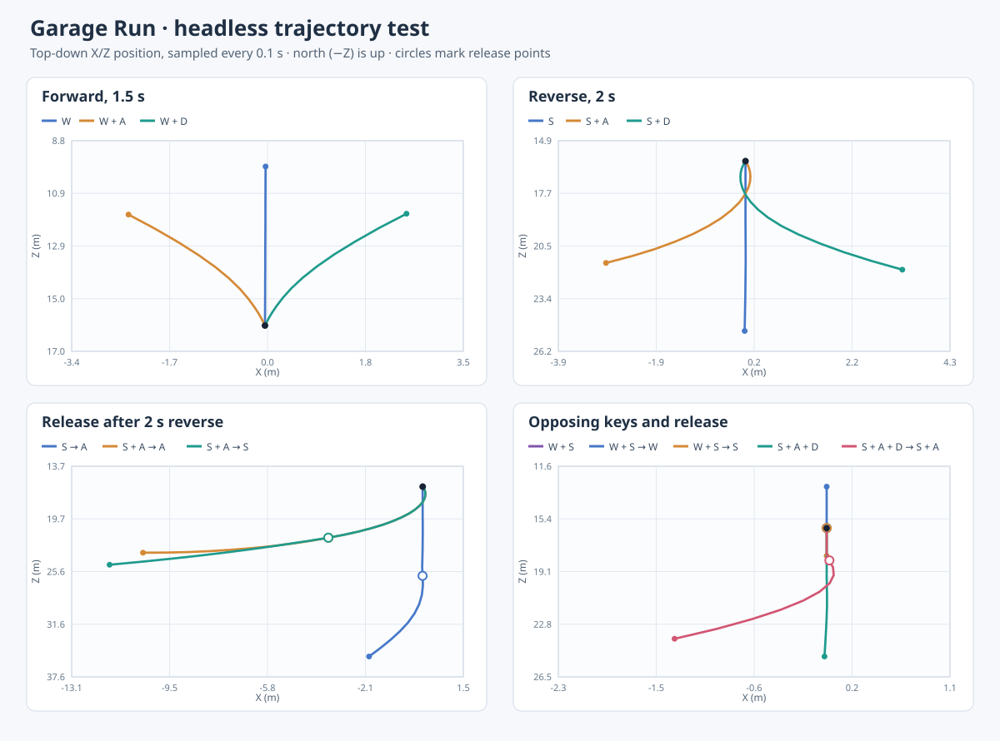

# Garage Run

A short 3D checkpoint and parking game made entirely from Lua, a source scene,
and project-local assets. No editor action is needed to play or change it.

From the repository root, run:

```sh
build/acuppa run games/garage_run
```

The 90×90 yard leaves room to practice turns and handbrake drifts; the marked
area to the right is an open drift pad. Drive through the two pairs of gold
posts in order, then brake early and stop inside the green parking bay. The
top bar shows the current goal, elapsed time, and wall hits. Finishing saves
the best time in this project's `saves/` directory, and you can keep driving.

| Action | Keyboard | Controller |
| --- | --- | --- |
| Accelerate / reverse | W / S | Right / left trigger |
| Steer | A / D | Left stick or D-pad |
| Drift handbrake | Left Shift | B button |
| Brake | Space | A button |
| Restart | R | Back |
| Exit | Escape | Start |

The car uses a Jolt four-wheel vehicle constraint: the rear wheels receive
drive torque, the front wheels steer, and the handbrake reduces rear tire grip.
Steering at rest turns the wheels without rotating the chassis. Steering angle
decreases as speed rises, and ordinary tire grip keeps left/right turns stable;
the handbrake still allows a drift. Walls and
obstacles are solid bodies, while gates and the parking bay are triggers. The
course uses PBR glTF meshes, an HDRI, a shadowed light, spatial engine,
skid, and impact sounds, and Lua UI. A wall hit moves the chase camera according
to contact angle and speed, then the view settles. Engine RPM raises motor pitch;
rear tire slip raises skid volume; harder hits make louder bumps. The small checked-in assets reproduce exactly with
`make_assets.py`; this is only needed when changing the asset generator.

SSAO is off in this game because it created camera-dependent bands on the flat
obstacles. The engine's SSAO feature remains available for other scenes.

## Headless handling check

The trajectory test runs the real Lua game and Jolt vehicle at 60 Hz without a
window or speaker output. It presses W/S and A/D together, releases one key at
a time, and records the car's ground position in
`build/garage_run_trajectory_fixture/trajectory.csv`. The plot shows the
measured paths; open circles mark input changes.



To repeat the test and draw a fresh plot from the repository root:

```sh
ctest --test-dir build -R garage_run_headless_trajectory --output-on-failure
python3 scripts/plot_garage_trajectory.py \
  build/garage_run_trajectory_fixture/trajectory.csv build/garage-run-trajectory.svg
```

Automated rules, gameplay, asset, Vulkan capture, and interactive startup tests
run with the engine suite. The standalone export passes device-free gameplay checks, a Vulkan capture, and
interactive startup. From the repository root, run `build/acuppa build
games/garage_run build/garage_run_release`, then launch
`build/garage_run_release/acuppa-game`. No editor or asset generator is needed.
