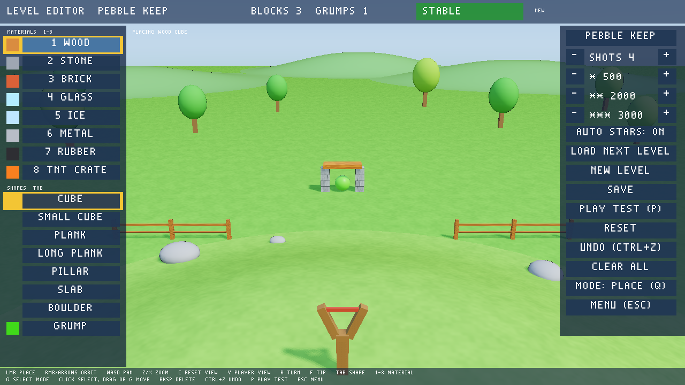

# Siege Sling

A 3D slingshot game made entirely from Lua, a source scene, level data, and
generated assets. A sling on a grassy hill launches a heavy red ball at one
fortress of blocks with round green grumps hiding on its floors and ledges. The sling
turns left and right as well as up and down. You have four shots per level;
knock out every grump to win and earn one to three stars.

Topple the fortress onto the grumps: every impact counts, so falling blocks
break other blocks and pop grumps they land on, and grumps that tumble to the
ground pop too. Orange crates explode when hit, pushing and damaging
everything within about 3 m and setting off nearby crates. Each further break
within one shot raises a combo multiplier (up to x5, shown as a COMBO popup),
so a chain reaction is worth far more than single hits.

The game opens on a title menu: Play starts the first level you have not
won yet, Levels lists every level with its best stars and score, and Quit
exits. Use the mouse, or Up/Down and Enter or Space. The Editor button
opens the in-game level editor; it appears only when the game runs from
source, because exported games cannot write project files. Two levels ship: Grassy Hill (one connected fortress of 51 wood, stone,
glass, and crate blocks) and Frozen Foundry (brick, ice, metal, and rubber
towers with a stone boulder perched over a grump).

Blocks break apart in bursts of debris when hit hard
enough (glass shatters easily, stone takes a solid hit), grumps pop when they
are struck or fall, and each material has its own impact sound. Win and lose
screens show your score, stars, and best result for that level, which is
saved between runs and shown in the top bar. The win screen offers Next
level (or press N), Play again, and Menu; Space always plays again. Escape
returns to the menu.

| Material | Role |
| --- | --- |
| Wood | Light; breaks from a solid hit |
| Stone | Heavy; needs a fast shot or a heavy fall |
| Brick | Between wood and stone |
| Glass | Shatters from gentle knocks |
| Ice | Shatters easily and is nearly frictionless, so it slides |
| Metal | Very heavy and almost unbreakable; crushes what it falls on |
| Rubber | Light and very bouncy; shrugs off most hits |
| Crate | Explodes, damaging and pushing everything within about 3 m |

From the repository root, run:

```sh
build/acuppa run games/siege_sling
```

| Action | Mouse / keyboard | Controller |
| --- | --- | --- |
| Pull and fire | Left-drag back from anywhere, release to fire | — |
| Turn aim left / right | A / D or Left / Right | Left stick X or D-pad |
| Raise / lower aim | W / S or Up / Down | Left stick Y or D-pad |
| Less / more power | Q / E | Left / right trigger |
| Fire | Space | A button |
| Orbit the aim camera | Right-drag | Right stick |
| Play again (win/lose screen) | Space, or Enter on the focused button | A button |
| Next level (win screen) | N or the Next level button | — |
| Restart | R | Back |
| Menu (in a level) / back / quit (title) | Escape | Start |

Dragging works like a real sling: pull down to lob higher, pull sideways to
aim the other way, and pull farther for more power. The dotted arc previews
the flight while you aim or drag; a tiny drag cancels instead of firing.

The camera waits behind the sling, follows the ball in flight, holds a view of
the fort while blocks settle, then eases back to the sling for the next shot.

## Files

- `game.lua`: window, scenes, input actions, and `writable = {"levels"}`.
- `scenes/menu.scene.lua` and `scripts/menu.lua`: title menu and level select.
- `scenes/play.scene.lua`: the static yard (ground, hill, sling, sun, camera)
  shared by every level. `scripts/play.lua` spawns the chosen level's blocks
  and grumps with physics from the rules' material table.
- `levels/index.lua`: the ordered level list. `levels/level1.lua` and
  `levels/level2.lua`: shots, star scores, and each fort's blocks and grumps.
- `scripts/session.lua`: loads levels with `tp.data_read`, remembers the
  chosen level across scene switches, and saves the best result per level.
- `scenes/editor.scene.lua`, `scripts/editor.lua`, and `scripts/editor_core.lua`:
  the level editor and its pure placement, stability, undo, and level-building
  logic.
- `scripts/catalog.lua`: the editor's shape palette (cube, small cube, plank,
  long plank, pillar, slab, boulder) and material display names and colors.
- `scripts/rules.lua`: pure aim, launch, arc, damage, shot-flow, and score rules.
- `scripts/camera_rig.lua` (views and impact shake), `scripts/drag_aim.lua`,
  and `scripts/debris.lua`: small engine-free modules.
- `make_assets.py`: regenerates every file in `assets/` exactly: textured
  glTF blocks (wood planks, stone courses, frosted glass, grass), the sling,
  ball, grumps, trees, rocks, fence, and far hills, the daytime HDRI, and the
  knock, thud, clink, pop, boom, and twang sounds, and a striped crate texture.

Scoring: glass 50, ice 75, wood 100, brick 150, rubber 150, crate 150,
stone 200, metal 500, each grump 500, times the combo multiplier, plus 1000
per unused shot on a win. Each level sets its own star scores (level 1:
6000, 14000, and 22000 points); a win always earns at least one. Three stars need a
big chain or a win with shots to spare.

SSAO is off: on this open meadow it drew visible bands across the grass.

## Level editor



Choose Editor on the title menu, or run
`build/acuppa run games/siege_sling --scene editor`. You build in the real
yard with the sling in view, and physics stays on: blocks fall, stacks
settle, and a structure that cannot stand topples in front of you. The top
bar shows STABLE once every body has stayed nearly still for 1.5 s. Otherwise
it shows UNSTABLE with the number of moving bodies, or SETTLING. Moving or
toppled blocks get a red marker. The editor snapshots the layout each time it
becomes stable after an edit, and Reset returns to that snapshot after a
collapse.

| Action | Control |
| --- | --- |
| Place the selected item (a preview follows the cursor) | Left click |
| Choose a material / shape or grump | 1-8 or palette / Tab or palette |
| Turn 90 degrees / tip over | R / F |
| Orbit / pan / zoom the camera | Right-drag or arrows / WASD / Z and X |
| Reset the view / toggle the player's view | C / V |
| Select mode: click to select, drag or G to move | Q |
| Delete the selection / undo | Backspace / Ctrl+Z |
| Play test / back to the menu | P / Escape (asks again if unsaved) |

Items snap to a 0.25 m grid on the ground. Over a block they rest on its top
face, centered on the cursor. The right panel cycles the level name through
generated names (there is no text input) and sets shots and star scores. The
star scores follow a suggestion from the blocks and grumps until you change
them. The panel also holds Load next level (it cycles through every indexed
level, including levels 1 and 2), New level, Save, Play test, Reset, Undo,
and Clear all (which asks first).

Save writes the settled layout (current positions and rotations, rounded to
millimeters) to `levels/<name>.lua` and adds or updates its entry in
`levels/index.lua`. It refuses to save while the layout is not STABLE or has
no grump, and says why. Play test runs the current layout with the real game
rules without saving. After a win, a loss, or Escape, you return to the
editor with the exact layout you left; repeat as often as you like. Undo
history and the snapshot are kept while you play test. Blocks may carry a
`rotation = {x, y, z}` field (radians, applied Y, then X, then Z).

## Adding a level by hand

1. Copy `levels/level1.lua` to, say, `levels/level3.lua` and edit it. It is
   plain data: `return { ... }` with no code. Each block has an `id`, a
   `material` (wood, stone, brick, glass, ice, metal, rubber, tnt), a
   `position` (block center in meters), and either `half_extents = {x, y, z}`
   for a box of any size or `shape = "sphere", radius = r` for a boulder.
   Targets have an `id` and a `position`. Start blocks exactly touching so
   the fort rests without settling impacts.
2. Add `{file = "levels/level3.lua", name = "My Level"}` to `levels/index.lua`.

That is all. `acuppa test games/siege_sling` loads and validates every indexed
level, and `Rules.validate_level` names any bad or unknown field. The game
reads levels when they are opened, so a new file shows up without a restart.
Per-level best results live in the `progress` save slot.

## Tests

```sh
ctest --test-dir build -R siege_sling --output-on-failure
```

`siege_sling_rules` and `siege_sling_play_modules` test the pure modules.
`siege_sling_gameplay` runs the real game headlessly with injected keys and
mouse drags, including the menu, level select, next level, per-level best
results, a two-shot win on level 2, and the editor. The editor checks cover
stacking, STABLE/UNSTABLE, Reset, save refusals, saving and validating a
level, repeated play tests, select/delete/undo, and Load.
`siege_sling_editor_live_startup` opens the editor window. `siege_sling_capture` checks Vulkan captures of the menu, the aim and follow
views, and the editor. `siege_sling_live_startup` opens the interactive window. `siege_sling_export`
and `siege_sling_export_capture` check the exported player.
