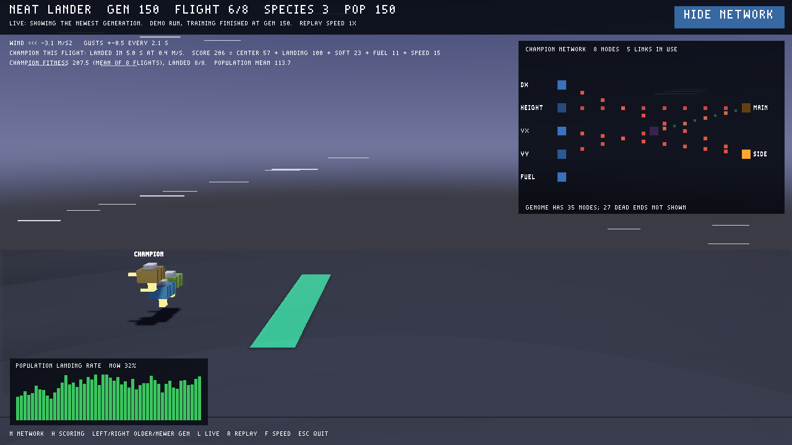

# NEAT lab: evolving a lander with ACuppa physics

This folder trains small neural networks with **NEAT** (NeuroEvolution of
Augmenting Topologies) to land a thruster craft on a pad in gusty wind. The
physics is the engine's Jolt world, and the result plays back as an ordinary
ACuppa game that runs without a player. It is separate from the engine:
nothing under `src/`, `include/`, or the root `CMakeLists.txt` is changed. The
lab links the unchanged `acuppa_core` library and runs its viewer with the
normal `build/acuppa` binary.

NEAT is an evolutionary method, not gradient-based reinforcement learning.
Each generation scores every network in the population. The best reproduce
with mutated weights. Occasionally a mutation adds a node or connection, so
networks start minimal and grow only when that helps. Similar networks are
grouped into species so a new structure gets time to improve before it has to
compete with the whole population.



## How it fits together

| Part | Language | Role |
| --- | --- | --- |
| `runner/` → `lander_runner` | C++, links `acuppa_core` | Reads a whole generation of networks plus that generation's scenarios on stdin, then flies every network through every scenario in Jolt. It runs with no window, uses one fresh physics world per flight, and evaluates networks in parallel threads. It writes each network's fitness, plus 30 Hz recordings with score parts for the networks asked to be traced. |
| `trainer/train.py` | Python, neat-python | Runs the NEAT loop, draws 8 new random scenarios each generation, and makes one runner call per generation. Afterwards it replays the champion and the best network of up to 7 other species on one of those scenarios, and writes `viewer/runs/gen_NNNN.lua` plus `status.lua`. |
| `viewer/` | ACuppa Lua project | Polls `runs/status.lua` once a second with `tp.data_read` and replays the recorded flights. Landers that fail are blown up where their flight ended. It also draws the wind, the champion's score, and the champion's network. Falls back to the checked-in `demo/` run when `runs/` is empty. |

Training does not render. A generation of 150 networks × 8 flights of up to
10 s takes about a third of a second on 12 threads. You watch replays instead: the viewer
shows exactly the recorded flights, so what you see is what was scored.

## Requirements and versions

- The engine's local toolchain from `bash scripts/bootstrap-local.sh` (pinned
  CMake, Zig, Ninja, Jolt v5.6.0, and the other engine dependencies in `.tools/`).
- **neat-python 2.0.0** (BSD-3-Clause) in its own ignored venv, using Python 3.12:

```bash
UV_CACHE_DIR=.tools/uv-cache uv venv .tools/neat-venv --python 3.12
```

```bash
UV_CACHE_DIR=.tools/uv-cache uv pip install --python .tools/neat-venv/bin/python neat-python==2.0.0
```

## Build, train, and watch

From the repository root, build the runner and tests into `build-neat/`:

```bash
bash neat_lab/configure.sh
```

Open the viewer. It plays the demo run until training output appears:

```bash
build/acuppa run neat_lab/viewer
```

In a second terminal, train. `--pace 2` holds each generation for at least
two seconds so the live viewer can show more of them. Without it, 150
generations finish in under a minute and the viewer skips most of them;
you can still rewatch every one afterwards.

```bash
.tools/neat-venv/bin/python neat_lab/trainer/train.py --generations 150 --pace 2
```

Other options: `--seed` (default 1; the same seed reproduces a run exactly,
weather included), `--pop-size`, `--threads`, `--config`, and `--out`. A new
run deletes earlier `gen_*.lua` files in the output folder and nothing else.

### What you see

Each generation is replayed as one flight of all its shown landers. All of
them start from the same random start state and fly through the same wind.

- The **gold** lander is the generation's champion, the network with the best
  fitness. The colored landers behind it are the best members of other species,
  one color per species ID.
- Thrusters show as flames. A lander that lands blinks a green beacon and
  plays a chime. A lander that fails explodes into debris where its flight
  ended. Failures are a crash, missing the pad, tipping over, running out of
  time, or flying away. A label shows each result.
- White streaks drift with the wind, which changes in strength and direction
  with every gust. The text under the header gives its current value, the gust
  size, and the gust period.
- The header shows the generation, which of its 8 flights is shown, the species
  count, and the population size. Below it are the champion's score for this
  flight, split into its parts, and its fitness averaged over all 8 flights.
- The bottom-left graph is the share of all flights in the whole population
  that landed, one bar per generation (up to the last 100). It is the clearest
  sign that the population is learning.
- The network panel in the top-right corner shows the champion's inputs on the
  left (offset from pad, height, horizontal and vertical speed, fuel) and its
  outputs on the right (main engine, side jets). Hidden nodes sit in columns
  by depth. Green dots are positive weights and red dots negative ones; bigger
  dots are weights above 1.5. Nodes and links brighten with the values
  recorded during the flight. Only nodes that feed an output are drawn. The
  panel's footer counts the dead-end nodes that mutations left in the genome.

### Viewer controls

| Key | Action |
| --- | --- |
| N, or the HIDE/SHOW NETWORK button in the top-right corner | Toggle the network panel |
| H | Show or hide how a flight is scored |
| Left | Rewatch the previous (older) generation. This leaves live mode, so the viewer stays on that generation and loops it. |
| Right | Rewatch the next (newer) generation. Pressing Right on the newest generation returns to live mode. |
| L | Back to live mode: show the newest generation and follow training |
| R | Restart the current replay |
| F | Toggle 1× / 3× replay speed |
| Escape | Quit |

While rewatching, the header says `REWATCHING GEN n` and how to get back.
Training keeps running in the background; the header always shows the newest
generation written so far.

## The task

The lander is a 0.9 × 0.6 × 0.9 m Jolt box (194 kg) moving in the X/Y plane.
The pad is 2 m wide at x = 0. Each tick, the network gets five inputs:
`x/10`, `height/10`, `vx/5`, `vy/5`, and `fuel` (0 to 1). It does not see the
wind; it has to react to the drift the wind causes. Two tanh outputs become a
main throttle (0 to 1, up to 2× the lander's weight) and side jets (−1 to 1,
up to 0.5× weight). A full tank lasts 6 s of full throttle, and the side jets
burn half as fast. The engines cut at touchdown, and the wind keeps blowing.

Every generation, all networks fly the same 8 new scenarios, drawn from
`--seed` and the generation number. Networks cannot memorize them, so a
champion can do worse the next generation if the weather turns against it.

| Value | Range per scenario |
| --- | --- |
| Start x | −12 to 12 m |
| Start height | 9 to 15 m |
| Start speed | vx −3 to 3 m/s, vy −2 to 0.5 m/s |
| Steady wind | −4 to 4 m/s² sideways (side jets give at most 4.9 m/s²) |
| Gusts | 0 to 2.5 m/s², a sine wave with a 1.5 to 5 s period |

### How a flight is scored

A flight ends at touchdown plus 1 s of settling, at a crash, after 10 s, or
when the lander leaves the area. Its score is the sum of five parts:

| Part | Points |
| --- | --- |
| Center | Up to 60 for ending close to the pad: 60 × (1 − \|x\| / 15), at least 0 |
| Landing | 100 landed; 40 missed the pad; 20 tipped over; 0 to 20 for a crash, less for harder hits |
| Soft | Up to 30 for touching down gently, if it did not crash: 30 × (1 − impact / 1.5 m/s) |
| Fuel | Up to 40 for fuel left, landings only |
| Speed | Up to 30 for landing sooner, landings only: 30 × (1 − touchdown time / 10 s) |

The outcomes are:

- **Landed:** touchdown at 1.5 m/s or less, upright 1 s later, and the centre
  within the pad.
- **Missed pad:** a soft, upright landing outside the pad.
- **Tipped over:** tilted more than about 18° 1 s after touchdown.
- **Crashed:** touchdown faster than 1.5 m/s.
- **Out of time:** no touchdown within 10 s. Only half the center points count.
- **Flew away:** |x| above 30 m or height above 40 m. Scores 0.

A network's fitness is the mean score over its 8 flights. A perfect flight
scores about 260, so the time limit and fuel make speed and thrift trade off
against a soft touchdown.

With seed 1, the population's landing rate climbs from 0% to roughly 30% over
150 generations. The champion usually lands 6 to 8 of its 8 flights by then,
and the species count varies between 1 and about 10. A hand-written
controller in the tests lands 87% of random scenarios, so the task can be
solved but is not trivial.

Engine limits that shaped the task: the engine exposes boxes, spheres, and
forces at the centre of mass, but no joints or torques. The lander therefore
stays upright in flight and can tip only on contact.

## Runner protocol

Input (whitespace-separated tokens):

```text
acuppa-lander 2
threads <n, 0 = all hardware threads>
scenarios <count, 1..64>
scenario <x> <y> <vx> <vy> <wind> <gust> <gust period>
trace_scenario <index into scenarios>
genomes <count>
genome <key> <trace 0|1> <node count>
node <key> <activation> <aggregation> <bias> <response> <link count> [<input key> <weight>]...
end
```

Nodes are neat-python `FeedForwardNetwork.node_evals` in evaluation order.
Input keys are −1..−5 and output keys are 0 and 1. Supported activations are
`tanh`, `sigmoid`, `relu`, `identity`, and `clamped`, using neat-python's
formulas. The only supported aggregation is `sum`.

Output:

```text
acuppa-lander 2
result <key> <mean fitness> <landed scenarios>
trace <key> <outcome> <impact> <touchdown time> <score> <center> <landing> <soft> <fuel> <speed> <frames> <nodes> <node keys...>
f <x> <y> <rx> <ry> <rz> <main> <side> <fuel> <wind> <node values...>
end
```

`result` comes once per genome. A traced genome adds a `trace` line followed
by its `f` frame lines. Malformed input exits with code 2 and a message on
stderr that names the bad token, scenario, or genome.

## Viewer data files

`gen_NNNN.lua` is an engine Lua data file (format 2), read with `tp.data_read`.
It holds:

- the generation statistics and the displayed scenario's weather
- the best-fitness and landing-rate histories
- the champion network: `network.nodes` with layout positions, and
  `network.connections`, including disabled genes
- the champion's activations
- up to 8 landers, each with its outcome and score parts

Each flight is packed into one string of `;`-separated frames, because engine
data files allow at most 10,000 table entries and 1 MiB. `status.lua` lists
the generations available and whether training is still running.

`trainer/make_demo.py` rebuilds `viewer/demo/` from a 150-generation, seed-1
run, keeping 11 of its generations. `viewer/make_assets.py` regenerates the
glTF boxes, the HDRI, and the explosion and landing sounds.

## Tests

```bash
.tools/venv/bin/ctest --test-dir build-neat -L neat_lab --output-on-failure
```

- `neat_lander_physics`:
  - free fall, climbing out of bounds, fuel use, fuel exhaustion, and side-jet direction
  - steady wind drift, gust timing, score parts summing to fitness, and a
    lower speed score for a slower landing
  - a hand-written controller landing at least 80% of 300 random scenarios,
    which shows the trainer's ranges can be landed
  - deterministic repeat episodes, and identical results with 1 or 8 threads
  - network maths matching neat-python, and rejection of bad networks, scenarios,
    and protocol input
- `neat_runner_protocol`: mutated neat-python genomes with hidden nodes go through
  the real runner. First-frame outputs must equal neat-python's own
  `activate()`, and different weather must give a different fitness. Also
  covers malformed batches and damaged runner output.
- `neat_trainer`:
  - the Lua data writer, and a network layout that drops dead-end and disabled-only nodes
  - random scenarios that are reproducible per seed and generation and cover their ranges
  - a seeded 3-generation training run: the published files, deletion of stale
    generations, sizes under 1 MiB, and an identical second run with the same seed
- `neat_viewer_headless`: runs the viewer through `LuaProject` with no window and checks:
  - the waiting screen and the demo
  - wind streaks and text, score parts, a landed beacon and label, and a crash
    replaced by debris and a CRASHED label
  - the N key and corner button toggles, and the H scoring panel
  - browsing older and newer generations, and Right on the newest returning to live
  - live mode loading a new generation, and damaged or unparsable run files

`build/acuppa test neat_lab/viewer` also checks the viewer scene with the
engine's own command. The screenshot above and the explosion were checked in
Vulkan captures (`--frames N --capture`). The live window was also run without
`--frames` while paced training wrote new generations.
