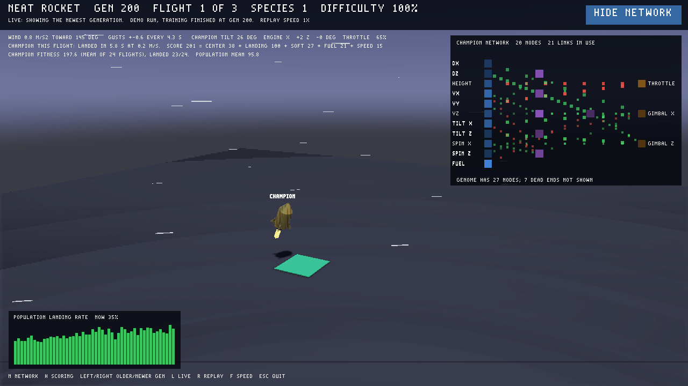

# NEAT rocket: a swiveling engine in 3D

A copy of [the NEAT lander](../neat_lab/README.md) with a harder craft. A tall
rocket flies in full 3D and has **one engine at its base that swivels up to 30°
each way on two axes**, measured from the rocket's own axis. It has no side
jets: to move sideways it must tip over and then straighten up again before
touchdown. The engine pushes through `apply_force_at`, the engine API added
for this, so a swiveled engine both pushes and turns the rocket.



## Run

```bash
bash neat_rocket/configure.sh
```

```bash
build/acuppa run neat_rocket/viewer
```

```bash
.tools/neat-venv/bin/python neat_rocket/trainer/train.py --generations 200 --pace 2
```

The trainer prints one line per generation, about one per second. The viewer
controls match the lander's: N network, H scoring, Left/Right older/newer
generation, L live, R replay, F speed, Esc quit.

Each generation is scored over **24 random flights**, each with a different
start position, speed, tilt, and wind; fitness is the mean. The viewer replays
**3 of them in turn** ("FLIGHT 1 OF 3"), spread across the 24, so you can see
whether a rocket lands from different places or only got lucky once.

## The task

| | |
| --- | --- |
| Rocket | 540 kg; a 1.0 × 1.8 × 1.0 m box collider (ACuppa has box and sphere colliders), drawn as a round body with a cone nose, four fins, and a flared engine bell |
| Engine | throttle up to 2× weight; swivels ±30° about the body's X and Z axes |
| Inputs (11) | pad offset x/z, height, velocity x/y/z, tilt x/z, spin rate x/z, fuel |
| Outputs (3) | throttle, gimbal x, gimbal z |
| Landed | touchdown ≤ 2 m/s, within 15° of upright 1 s later, centre on the 3 m square pad |
| Failures | crash, missed pad, tipped over, tumbled (past horizontal in the air), out of time (12 s), flew away |
| Weather | steady wind up to 2 m/s² in any ground direction, gusts up to 1 m/s², unseen by the network |

The score has the lander's five parts, with two changes that make getting
closer pay. Center is 60 × e^(−distance / 3 m): 60 on the pad, 22 at 3 m, 8 at
6 m. Missing the pad earns 20 for landing instead of 40. Failures get partial
credit, so slowing down pays before landing is learned: a crash earns up to 40
the slower it is, a tumble up to 20 the longer it stayed upright, and running
out of time 20.

**Difficulty** starts at 0%: calm air and an upright start, 0 to 2.4 m from
the pad, so even the first flights need some steering. Speeds, tilts, wind,
and start offsets (up to 8 m) grow by 5% after each generation whose champion
lands 75% of its flights, and shrink by about 1.7% after one that lands 15% or
fewer. The header shows the current level.

## How it learns to steer

The first version never learned to use the engine swivel; champions only set
the throttle and dropped straight down. Three changes fixed that:

- **Innate balance and descent.** Generation 1 starts from one simple rocket
  instead of random networks. Tilt and spin feed the matching swivel (a
  balance reflex, like a hand under a broom), and height and vertical speed
  set the throttle for a gentle straight descent. All other links start at
  weight 0. Evolution must still discover steering toward the pad, handling
  the wind, and saving fuel, and it may change or drop the innate links. Run
  with `--no-reflex` to start from random networks instead.
- **Small, rare mutations.** The swivel is very sensitive: a fixed 7° swivel
  already makes a rocket miss the pad. A child now changes about 20% of its
  weights by about 0.15 each, instead of 80% by 0.5, so a working rocket's
  children still fly.
- **24 flights per generation instead of 8**, so a lucky champion rarely
  beats a better one.

Probes that led there: a hand-built network with the reflex plus four
steering links (pad offset and velocity to each swivel) lands 64 of 64 flights
at 30% difficulty, while dropping straight lands 6. With the reflex in place,
each steering link improves landings on its own, so evolution can find them
one at a time. Without it, any swivel link alone makes the rocket flip.

## Current result

With seed 1 (the checked-in demo; about 4 minutes on 12 threads):

| Generation | Champion lands | Difficulty | Population lands |
| --- | --- | --- | --- |
| 1 | 12 of 24 | 0% | 50% |
| 20 | 11 of 24 | 40% | 15% |
| 60 | 20 of 24 | 70% | 22% |
| 80 | 16 of 24 | 100% | 20% |
| 200 | 23 of 24 | 100% | 35% |

From generation 80 the flights are at full difficulty: starts up to 8 m from
the pad, sideways and falling speed, tilt, and gusty wind. The champion leans
and swivels its engine to steer, and its network grows from the 6 innate links
to about 26. A hand-written controller in the tests (`oracle` in
`tests/rocket_test.cpp`) lands at least 70% of the same flights. The
population often stays in a single species because mutations are small, so
the viewer usually shows only the champion.

## Tests

```bash
.tools/venv/bin/ctest --test-dir build-rocket -L neat_rocket --output-on-failure
```

- **`neat_rocket_physics`:**
  - free fall, climb, and centered thrust staying upright
  - +X and +Z gimbal turning the rocket about the expected axes, wind direction
  - the oracle landing every sample and most random flights
  - deterministic and parallel-equal batches, and protocol errors
- **`neat_rocket_runner_protocol`:** runner outputs match neat-python's own
  network for tilted starts; weather changes fitness; damaged input and output.
- **`neat_rocket_trainer`:**
  - the difficulty levels, their adaptive steps, and the minimum start offset
  - the innate links and zeroed output biases of generation 1
  - reproducible scenarios and the 3 replayed flights spread over the 24
  - a seeded 3-generation run with its viewer files
- **`neat_rocket_viewer_headless`:**
  - the HUD (wind heading, engine angles, difficulty) and engine bells with flames
  - the 3 replayed flights playing one after another
  - network and scoring toggles, and browsing back to live
  - crash debris, live updates, and damaged files

The rocket's runner protocol is the lander's with the header
`acuppa-rocket 1`. A scenario has 12 values:
`x y z vx vy vz tilt_x tilt_z wind wind_heading gust gust_period`. A frame has 12
values: `x y z rx ry rz throttle gimbal_x gimbal_z fuel wind_x wind_z`.
